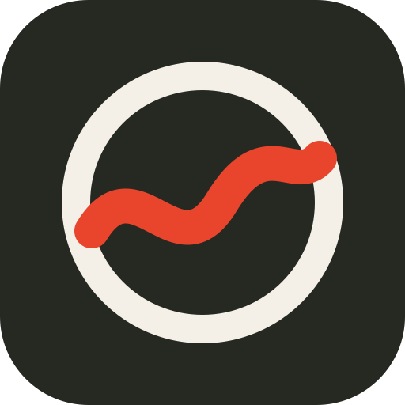
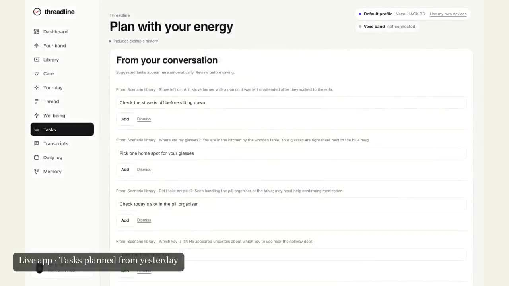
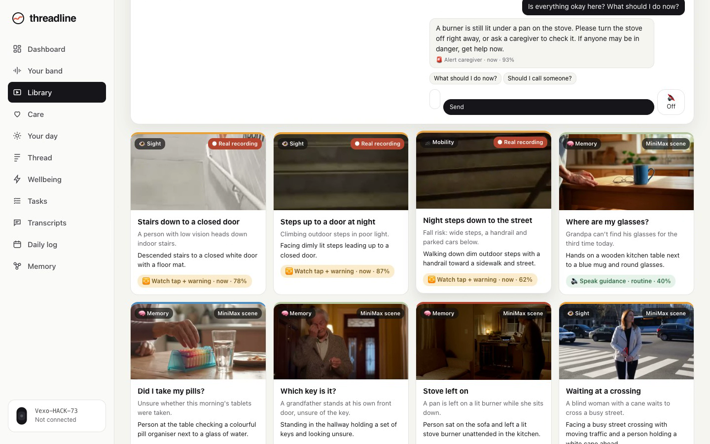
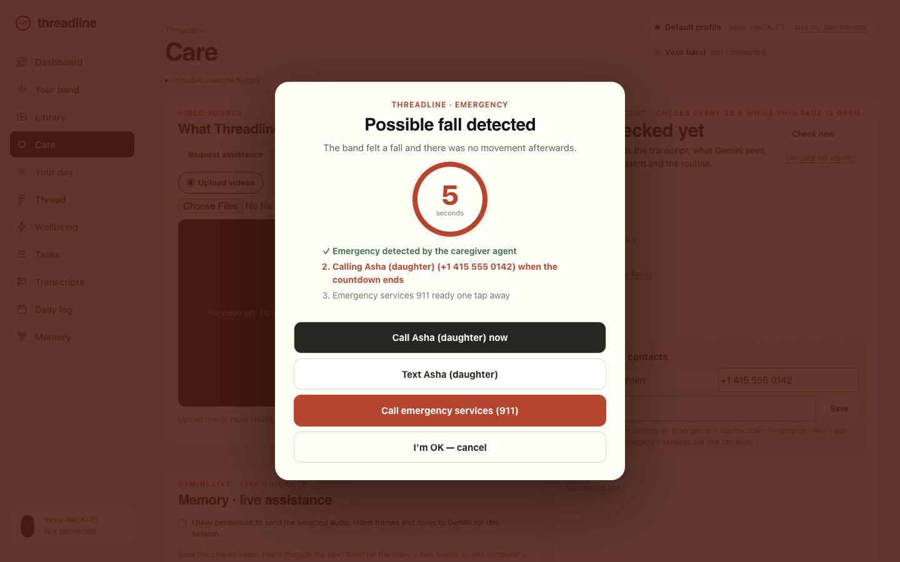
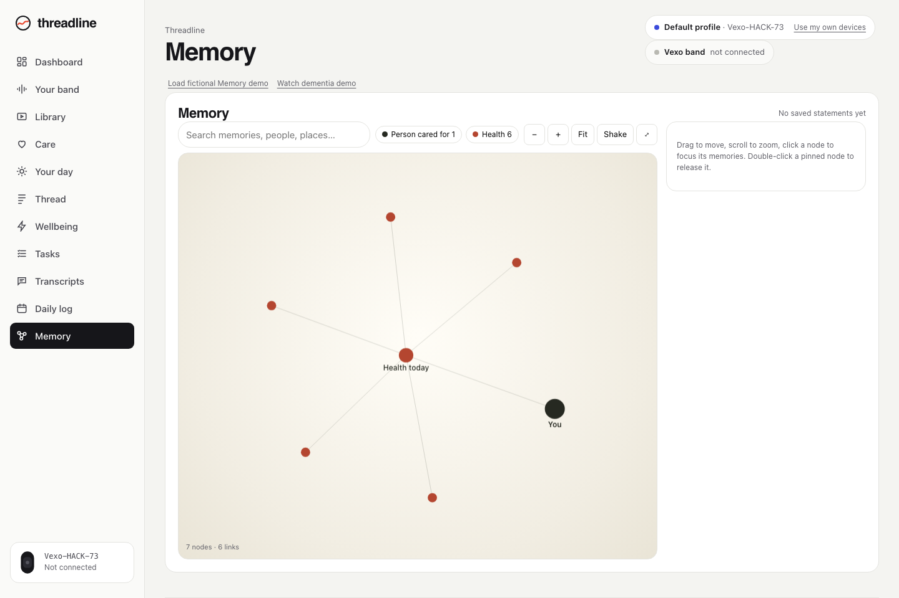
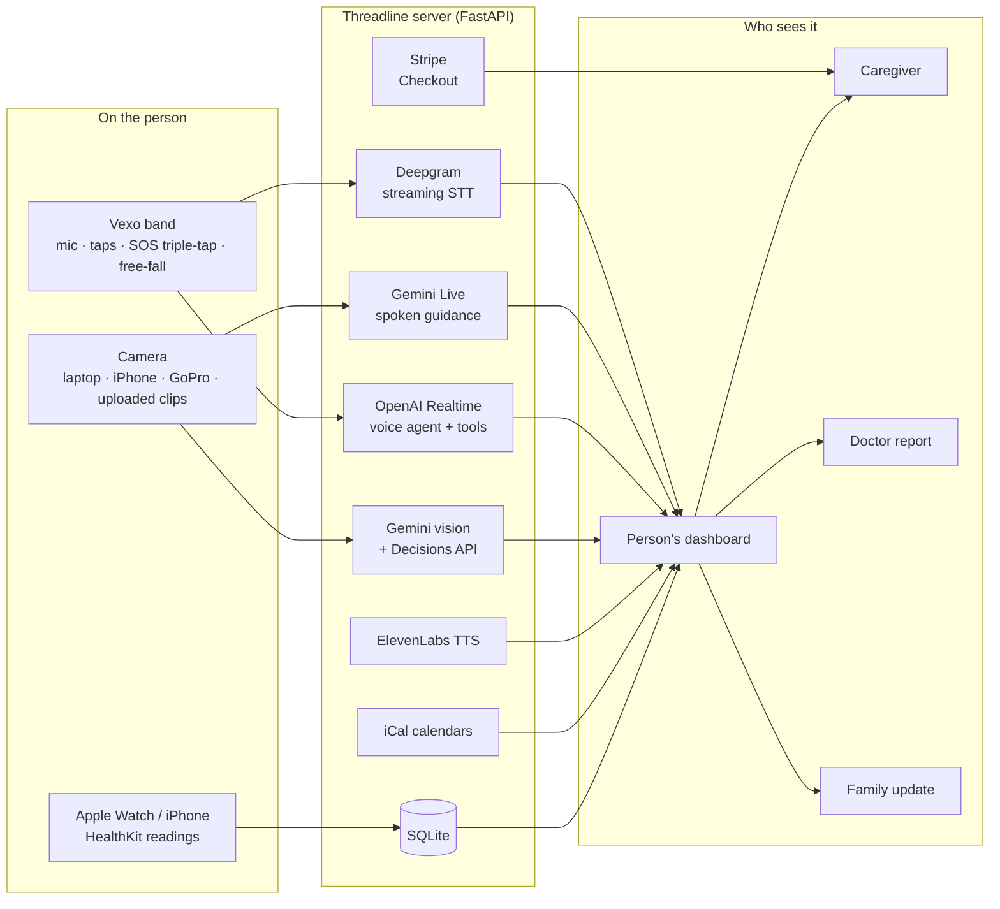

<p align="center">
  
</p>

<h1 align="center">Threadline</h1>

<p align="center"><strong>One band. Everyone cared for.</strong></p>

<p align="center">
  A wearable care companion that remembers, sees, listens and helps: one assistant with four ways to help (Memory, Sight, Hearing and Mobility) for older adults, people with disabilities and the people who care for them.
</p>

<p align="center">
  <a href="https://threadline.ayushojha.com/"></a>
</p>

<p align="center">
  
  
  
  
  
  <a href="pyproject.toml"></a>
  
</p>

<p align="center">
  <a href="https://threadline.ayushojha.com/static/media/threadline-story.mp4">
    
  </a>
  <br>
  <sub>▶ Click to watch the 2½-minute story film</sub>
</p>

<p align="center">
  <a href="https://threadline.ayushojha.com/"><b>Live app</b></a> ·
  <a href="https://threadline.ayushojha.com/static/media/threadline-story.mp4"><b>Watch the film</b></a> ·
  <a href="https://threadline.ayushojha.com/#library"><b>Scenario library</b></a> ·
  <a href="https://threadline.ayushojha.com/#dashboard"><b>Dashboard</b></a>
</p>

---

## 💡 The problem

Everyday tasks get harder when the world assumes you can remember the last step, read small print, hear a conversation or move easily.

- 🫖 Someone loses their place while making tea, or forgets whether the stove is still on.
- 👓 A package label is too small to read; a step at night is hard to see.
- 👂 A doorbell, a missed call or a spoken update goes unheard.
- 🚶 A fall happens and nobody is in the room.

The usual answer is four separate apps, each needing the person to explain the context again at exactly the wrong moment, while caregivers piece the day together from phone calls.

## 🧵 What Threadline does

Threadline carries context across those moments. A **Vexo band** listens (with consent) and picks up taps and falls, a **camera** gives it eyes, and **Apple Health** adds real readings. One assistant turns that into a single useful next step, and a caregiver sees the same picture on one dashboard.

The person chooses a support mode. It changes how the assistant listens, speaks and presents information; it never infers a disability.

| Mode | A useful moment | What Threadline does |
| :-- | :-- | :-- |
| 🧠 **Memory** | "What was I doing before the phone rang?" | Recalls stated plans and last mentioned locations from saved conversation and camera context, with timestamps and uncertainty. |
| 👁️ **Sight** | "What does this package say?" | Describes what the camera sees and reads legible text aloud. Unclear text stays unclear; it never identifies faces. |
| 👂 **Hearing** | "What did they just say?" | Large live captions with speaker numbers, multilingual transcription and a name cue that can notify a paired watch. |
| 🦽 **Mobility** | "Please ask Morgan to come over." | Keeps access preferences and movement readings in context and prepares an assistance message for review. |

## 📸 Screenshots

<table>
  <tr>
    <td align="center" width="33%"><br><b>Dashboard</b><br><sub>Today at a glance, Apple Health trends, action items and one-tap reports</sub></td>
    <td align="center" width="33%"><br><b>Scenario library</b><br><sub>15 scenario videos reasoned on by Gemini</sub></td>
    <td align="center" width="33%"><br><b>Live guidance</b><br><sub>Chat with Gemini about the stove scene</sub></td>
  </tr>
  <tr>
    <td align="center"><br><b>Emergency alert</b><br><sub>Countdown, then the dialer for the emergency contact</sub></td>
    <td align="center"><br><b>Daily log</b><br><sub>A self-filling log of every Health metric</sub></td>
    <td align="center"><br><b>Memory graph</b><br><sub>Obsidian-style map of people, places and routines</sub></td>
  </tr>
</table>

## ⚙️ How it works



The browser owns the device connection (the official Vexo kit over USB or BLE). Every provider key stays on the server, which relays audio, frames and requests. A care agent re-checks the person's context every 30 seconds while the page is open and raises the emergency flow on a fall, an SOS triple-tap or a spoken call for help.

## ✨ Features

**🗣️ Talk to Threadline.** A speech-to-speech voice agent (OpenAI Realtime over WebRTC, with a Gemini + ElevenLabs path) that answers in the person's language and can act through tools: add to cart and check out, add tasks, remember and recall facts, read and add calendar events, log mood and energy check-ins, switch modes, run a care check and start the emergency flow.

**👁️ Live guidance.** Gemini Live watches a camera, uploaded clip or GoPro feed and speaks one grounded next step, shaped by the selected mode. Consent is required before anything is sent.

**🎬 Scenario library.** 15 scenario videos (3 recorded by the team, 12 generated with MiniMax Hailuo-02). Gemini looks at the frames, the Gemini Decisions API picks one action and an urgency, and you can chat with Gemini about any video. Your own uploads are stored per visitor and reasoned on the same way.

**🚨 Emergency flow.** A fall, an SOS triple-tap on the band or a spoken call for help opens a full-screen alert with a 10-second countdown, then the phone dialer for the saved emergency contact, with a text option and the emergency number one tap away. The person places the call.

**🛒 Essentials and voice orders.** Groceries, over-the-counter health items and home-safety supplies from a server-side catalogue, paid with Stripe Checkout after caregiver approval. Voice orders read back the items and total and wait for a spoken yes.

**📅 Calendar.** Connect Google, iCloud or Outlook calendars through their private iCal links (no OAuth). The assistant can read upcoming events and prepare new ones for the person to confirm.

**📓 Daily log and Wellbeing check-ins.** A daily log that fills itself from Apple Health, plus a quick caregiver mood check-in (mood, evening agitation, repeated questions) and self-reported energy.

**🕸️ Memory graph.** An Obsidian-style force graph of the people, places, objects and routines in saved conversations, with search, drag and zoom.

**📄 Reports.** One-tap daily care report, 30-day doctor summary and weekly family update, built from the same evidence and clearly labelled when they include example values.

## 🛡️ Safety and privacy

- **Never diagnoses.** Every model prompt forbids it, and the server strips diagnosis wording from care assessments and insights.
- **Never confirms medication.** Any claim that pills were taken is rewritten to "let's check the pill organiser together".
- **No face identification.** It describes what it sees but never says who someone is.
- **Keys stay server-side.** The browser never holds a provider key; the server relays every call.
- **Per-visitor isolation.** Each guest session is bounded and rate-limited, and only sees its own recordings and saved card.
- **Caregiver approval for purchases.** Orders record who approved them; the assistant never claims a payment went through.
- **Spending limit.** Voice orders are capped (default $100, `ESSENTIALS_VOICE_LIMIT_USD`); bigger orders go through Checkout. Prescription medicine is never sold.
- **Calls stay with the person.** A web page cannot place a call; Threadline opens the dialer and never claims help is on the way.

> Threadline is a hackathon prototype, not a medical device, diagnostic service or emergency response system.

## 🧰 Tech stack

| Layer | Technology |
| :-- | :-- |
| Server | Python 3.11+, FastAPI, Uvicorn, httpx, websockets, SQLite |
| Frontend | Vanilla JavaScript ES modules, installable PWA, no build step |
| Hardware | Vexo band (official Vexo Open kit, vendored), Apple Watch app, iPhone HealthKit uploader, Open GoPro bridge |
| Speech | Deepgram (streaming STT), OpenAI Realtime (speech to speech), ElevenLabs (TTS) |
| Reasoning | Gemini Live, Gemini vision, Gemini Decisions API |
| Commerce and calendars | Stripe Checkout, iCal (ICS) feeds |
| Media | MiniMax Hailuo-02 scenario videos |
| Deploy | Docker on a VPS behind Traefik |

## 🚀 Run it locally

Requirements: Python 3.11+ and [uv](https://docs.astral.sh/uv/). Node is only needed for the JavaScript tests.

```bash
cp .env.example .env          # first time only; fill in the keys you need
uv sync --locked
uv run uvicorn app.main:app --host 127.0.0.1 --port 8000
```

Open `http://127.0.0.1:8000/`. Set only the keys for the features you want; anything without a key says so instead of pretending to work.

| Variables | Purpose |
| :-- | :-- |
| `APP_HOST`, `APP_PORT`, `APP_ACCESS_TOKEN`, `APP_GUEST_SESSIONS`, `APP_PUBLIC_ORIGIN`, `APP_TRUST_LOOPBACK` | Server access and bounded guest sessions |
| `GOOGLE_API_KEY`, `GEMINI_MODEL`, `GEMINI_DECISION_MODEL`, `GEMINI_LIVE_MODEL` | Gemini reasoning, decisions and live guidance |
| `OPENAI_API_KEY`, `OPENAI_REALTIME_MODEL`, `OPENAI_TRANSCRIBE_MODEL`, `OPENAI_REALTIME_VOICE` | Talk to Threadline over OpenAI Realtime (optional) |
| `DEEPGRAM_API_KEY`, `DEEPGRAM_MODEL`, `DEEPGRAM_LANGUAGE`, `DEEPGRAM_ENDPOINTING_MS`, `DEEPGRAM_DIARIZE_MODEL` | Live transcription |
| `ELEVENLABS_API_KEY`, `ELEVENLABS_VOICE_ID`, `ELEVENLABS_MODEL`, `ASSISTANT_VOICE_ID`, `ASSISTANT_MULTILINGUAL_MODEL` | Spoken replies and narration |
| `STRIPE_SECRET_KEY`, `ESSENTIALS_VOICE_LIMIT_USD` | Essentials checkout and voice-order cap |
| `VEXO_BAND_NUMBER` | Your team's assigned band (this project uses 73) |
| `MINIMAX_*`, `COMFYUI_DIR`, `PYTHON_RUNTIME`, `LOCAL_COMFY_URL` | Optional media generation tooling |

Never commit `.env`. See [.env.example](.env.example) and [docs/API_SETUP.md](docs/API_SETUP.md) for details.

**Tests**

```bash
uv run pytest
node --test tests/*.test.mjs
```

**Deploy:** `./deploy/deploy.ps1` builds a commit-tagged image on the VPS from the committed revision only (never local `.env` files). See [deploy/README.md](deploy/README.md).

## 🗂️ Project structure

```text
threadline/
├── app/              FastAPI server: relays, agents, Stripe, calendars, storage
│   └── static/       Browser app (dashboard, library, care, essentials, graph) + vendored Vexo kit
├── watch/            watchOS app (live heart rate, cues)
├── phone/            iPhone HealthKit uploader
├── tools/            GoPro bridge and media tooling
├── tests/            pytest + node:test suites
├── deploy/           Docker Compose and VPS deploy helper
├── assets/demo/      Presentation films and images
└── docs/             Setup guides, demo scripts, screenshots
```

---

<details>
<summary><b>🔌 Connect the hardware</b></summary>

Set `VEXO_BAND_NUMBER` to your assigned band. This project uses **73**. In **Your band**, connect only that device and grant recording consent. Close the Vexo dashboard first: one connection must own its audio stream. The official kit is vendored unchanged under `app/static/vendor/vexo-open/` and records its upstream revision.

Camera options include the computer camera, uploaded clips played as a feed, and the Open GoPro bridge:

```bash
uv run python tools/gopro_bridge.py --server http://127.0.0.1:8000
```

A local video preview is not proof of remote streaming or AI analysis. See the [capture handoff](docs/LIVE_CAPTURE_HANDOFF.md), [hardware setup](docs/HARDWARE_SETUP.md), [watch app](watch/README.md) and [iPhone app](phone/) for their setup paths.

</details>

<details>
<summary><b>📊 Status</b></summary>

| Surface | Current state |
| --- | --- |
| Band audio → transcript | Implemented with the official Vexo kit and a server-side Deepgram relay. Partial text renders in the band and Care views. |
| Camera → spoken assistance | Gemini Live relay for a camera, uploaded clips or the GoPro bridge; explicit consent required. |
| Mode-specific behaviour | Implemented for Memory, Sight, Hearing and Mobility. |
| Memory and Dashboard | Saved notes, source links, transcript history, graph and available chart data; missing measurements remain missing. |
| Assistance and reports | Reviewable drafts, copy/download, and system email/text links. Sending and delivery are not automated or confirmed. |
| Triple-tap / name cue | App gesture and cue paths implemented; physical band/watch verification remains necessary. |
| Clinical predictions / navigation | Not implemented or validated. No diagnosis, medication verification, fall-risk score or safe-crossing guarantee. |

</details>

<details>
<summary><b>🎥 Try the demo and presentation assets</b></summary>

1. Open the [live site](https://threadline.ayushojha.com/) and choose a support mode.
2. Open **Thread**, **Transcripts** or **Memory**. The example conversation history is included in the regular app.
3. With recording/processing consent, ask a question for a fresh response based on the selected mode's notes, then follow its source links.

The four scenarios contain 111 written dialogue lines across 19 conversations, plus 14 days of clearly labelled synthetic chart values. They are illustrative inputs, not patient histories or device measurements.

| Asset | Use |
| --- | --- |
| [Story film](https://threadline.ayushojha.com/static/media/threadline-story.mp4) | The 2½-minute film, featuring the illustrative character Evelyn alongside app captures. |
| [Son-perspective cut](https://threadline.ayushojha.com/media/son-cut/newfilm.mp4) | Two minutes: visual reasoning, a Nepali response and source-linked Memory. |
| [Project media kit](https://threadline.ayushojha.com/media/) | App screenshots, thumbnail, scripts and the earlier concept film. |
| [Four-mode concept film](assets/demo/accessibility/threadline-four-modes.mp4) | About 59 seconds; synthetic scenes and illustrative UI. |
| [Memory evidence film](assets/demo/dementia/threadline-dementia-demo.mp4) | About 55 seconds; the interrupted-routine scenario and a captured Gemini response. |
| [Judges runbook](docs/demo/JUDGES_RUNBOOK.md) · [Video script](docs/demo/FINAL_VIDEO_SCRIPT.md) | Presentation flow and narration. |
| [Shot list](docs/demo/ACCESSIBILITY_VIDEO.md) · [Local image workflow](docs/demo/LOCAL_IMAGE_RUNTIME.md) | What the pitch shows and how the image assets were made. |

These films are presentation assets. They do not prove live wearable behaviour.

</details>

<details>
<summary><b>🔗 API overview</b></summary>

Principal endpoints: `GET /api/health`, `WS /api/live-transcribe`, `WS /api/live-gemini`, `POST /api/reflect`, `POST /api/vision`, `POST /api/agent/decide` and `POST /api/care/assess`. The Realtime voice agent exchanges its WebRTC SDP at `/api/realtime/sdp`. Watch pairing, camera bridge and Health import routes have separate authorization paths; see their setup docs.

</details>

<details>
<summary><b>⚠️ Limits and data handling</b></summary>

- This is a hackathon prototype, not a medical device, diagnostic service or emergency response system.
- A last mentioned object location is not its verified current location. Speaker numbers are not identities. A device free-fall event is not proof a person fell.
- Sight mode does not recommend a medication dose, replace mobility aids or determine when to cross a street.
- Consent is required for live guidance. Audio and selected frames go to the configured providers when enabled.
- Ordinary notes and transcripts are stored in the browser per band. The owner's published demo stream, uploaded videos and imported Health history can use server SQLite.
- Example history appears alongside real captures with source labels. Empty data does not imply that someone is safe or unwell.
- A message draft, requested watch cue or opened dialer is not confirmed delivery. Hardware latency, gesture recognition and watch cues require physical testing.

</details>

<details>
<summary><b>🤝 Contributing</b></summary>

Preserve consent and authorization boundaries, the official Vexo kit, source labels and the separation of example inputs from real assessments. Keep model selection in environment configuration. Only the `ayushozha` account pushes directly to `main`; other contributors use reviewed pull requests. Never commit private recordings, personal Health data or secrets.

</details>

## 📜 License

No project license file is currently checked in. The vendored Vexo Open kit keeps its own [license](app/static/vendor/vexo-open/LICENSE) and attribution.

## 🙌 Credits

Built by [Ayush Ojha](https://github.com/ayushozha) at **VexoHacks 2026**, with the Vexo band, Gemini, OpenAI Realtime, Deepgram, ElevenLabs, Stripe and MiniMax.

<p align="center"><sub>🧵 Threadline · One band. Everyone cared for.</sub></p>
