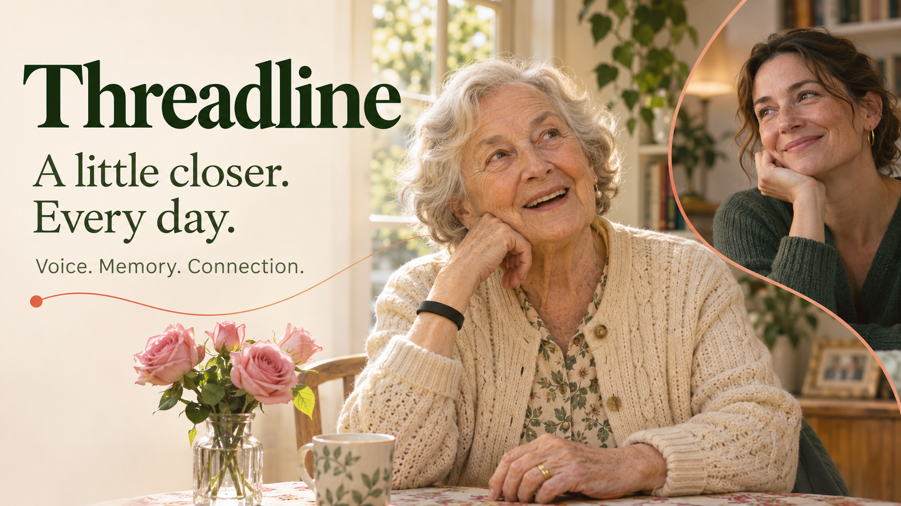
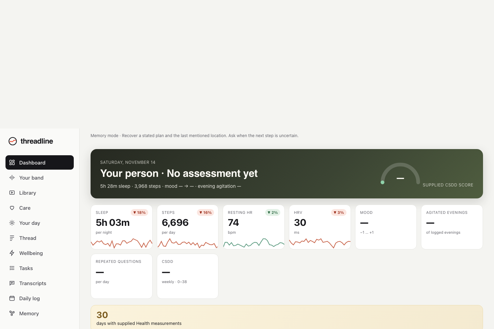
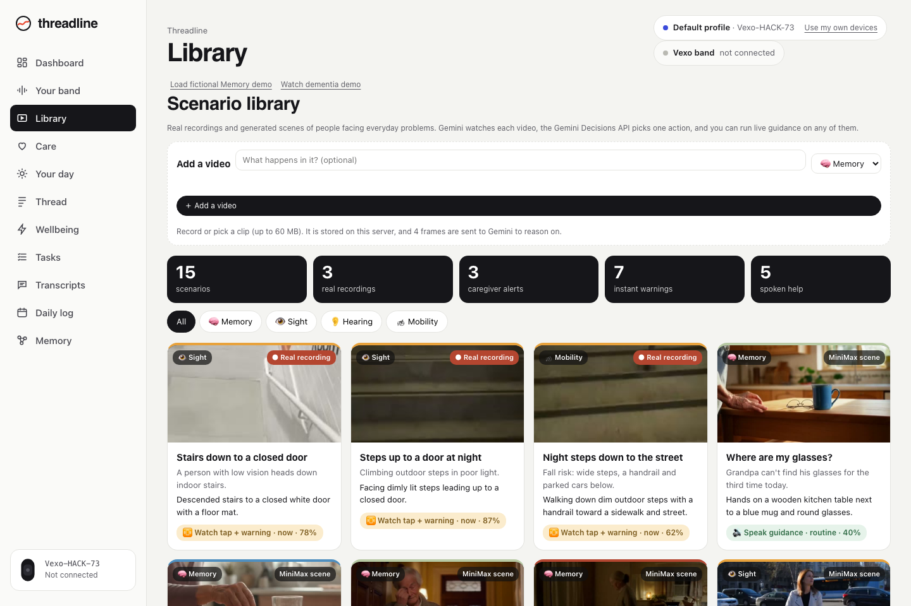
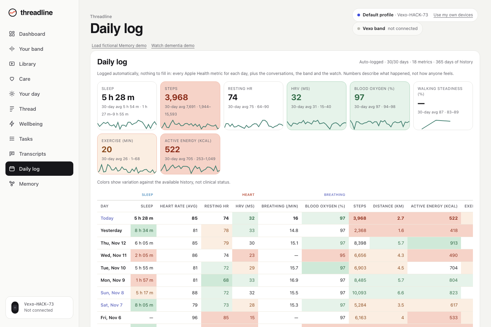

# Threadline

**One assistant, four chosen ways to help: Memory, Sight, Hearing and Mobility.**

[Live prototype](https://threadline.ayushojha.com/) · [Project media](https://threadline.ayushojha.com/media/) · [Judge presentation](docs/demo/JUDGES_RUNBOOK.md) · [Watch the concept film](https://threadline.ayushojha.com/accessibility/) · [Try the evidence demo](https://threadline.ayushojha.com/demo/) · [Video script](docs/demo/FINAL_VIDEO_SCRIPT.md) · [Device setup](docs/LIVE_CAPTURE_HANDOFF.md)

[](#status) [](pyproject.toml) [](#connect-the-hardware)

[](https://threadline.ayushojha.com/accessibility/)

Voice · visual context · accessible captions · personal memory · assistance drafts

## ▶ Watch the story (2½ minutes)

[](https://threadline.ayushojha.com/static/media/threadline-story.mp4)

**[Play the video](https://threadline.ayushojha.com/static/media/threadline-story.mp4)** · **[Open the live app](https://threadline.ayushojha.com/)** · [Scenario library](https://threadline.ayushojha.com/#library) · [Dashboard](https://threadline.ayushojha.com/#dashboard)

The film uses the illustrative character Evelyn to show everyday memory and accessibility support, alongside app captures. A separate [two-minute son-perspective cut](https://threadline.ayushojha.com/media/son-cut/newfilm.mp4) shows fresh visual reasoning, a verified Nepali text response and source-linked Memory. Opening a phone dialer is not a completed emergency call.

| Dashboard | Scenario library | Gemini on the stove scene |
|---|---|---|
|  |  |  |
| **Emergency alert** | **Daily log** | **Memory map** |
|  |  |  |

### What's live at [threadline.ayushojha.com](https://threadline.ayushojha.com/)

- **Dashboard:** today at a glance, real Apple Health trends, action items, one-tap reports for caregiver, doctor and family.
- **Library:** 15 scenario videos (3 real recordings, 12 MiniMax Hailuo scenes). Gemini watches each one, the **Gemini Decisions API** picks one action and urgency, and you can chat with Gemini about any video (spoken replies). Your own recordings are stored per visitor and reasoned on the same way.
- **Care:** a Gemini Live guidance path, a caregiver agent every 30 s while the page is open, and an **assistance flow**: a possible incident can show a 10-second countdown and request the phone dialer. The person completes the call; placement and delivery are not verified.
- **Essentials:** groceries, over-the-counter health items and home-safety supplies suggested from what Threadline noticed, caregiver-approved, paid with **Stripe Checkout** (needs `STRIPE_SECRET_KEY`; never sells prescription medicine).
- **Tasks, Wellbeing, Daily log, Memory:** suggestions built from the library, Care and Health; a 10-second caregiver mood check-in; a self-filling daily log of every Health metric; an Obsidian-style memory graph.
- **Language:** live transcription is multilingual and Gemini answers in the person's language (the film shows Nepali).

## The problem

Everyday tasks become harder when an interface assumes you can remember the last step, see small text, hear a conversation or easily reach something. Someone may lose their place while making tea, miss a spoken update, struggle to read a package or need help with an object out of reach. Opening another app, repeating the context and explaining what help is needed adds work at exactly the wrong moment.

Threadline carries context across those moments. It combines the person's saved words, a current camera view and available wearable inputs to offer one useful next step. The person chooses the kind of support, checks the evidence and decides what to share. A caregiver can review the same context without the system pretending to know more than it observed.

**The pitch:** different access needs should not require four disconnected assistants. Threadline changes how one assistant listens, responds and presents information around the support a person chooses.

## Contents

- [Four support modes](#four-support-modes)
- [Try the demo](#try-the-demo)
- [Status](#status)
- [How it works](#how-it-works)
- [Run locally](#run-locally)
- [Connect the hardware](#connect-the-hardware)
- [Configuration and API](#configuration-and-api)
- [Limits and data handling](#limits-and-data-handling)
- [Development](#development)

## Four support modes

Choose a mode on the Dashboard. It changes Gemini Live's instructions, the Care assessment context, captions and report wording; it does not infer a disability.

| Mode | A useful moment | What the prototype does |
| --- | --- | --- |
| **Memory** | “What was I doing before the phone rang?” | Retrieves a stated plan or last mentioned location from saved conversation. Uses visual context where available, with timestamps and uncertainty. |
| **Sight** | “What does this package say?” | Describes visible objects and reads legible text from camera frames. Unclear text remains unclear; it does not identify faces or guarantee a safe route. |
| **Hearing** | “What did they just say?” | Displays large live captions with speaker numbers and corrections. A chosen-name cue can request a notification from a paired watch. |
| **Mobility** | “Please ask Morgan to come over.” | Keeps access preferences and available movement readings in context, and prepares an assistance message for review. It does not calculate fall risk or direct a physical transfer. |

All four use the existing Dashboard, transcript archive, Memory graph, saved notes and report previews. **Wellbeing** presents available sleep, activity and heart information; the app does not turn these readings into a diagnosis or a prediction of difficult evenings.

## Try the demo

1. Open the [live site](https://threadline.ayushojha.com/) and choose a support mode.
2. Open **Thread**, **Transcripts** or **Memory**. The conversation history is included in the regular app; no separate demo screen is needed.
3. Explore the conversations, Memory graph and Dashboard. With recording/processing consent, ask a question for a fresh response based on the selected mode’s notes. Examples retain source metadata and never replace recorded data.
4. Follow its source links. Your own saved notes and recordings keep their original sources alongside the example history.

The four scenarios contain **111 written dialogue lines across 19 conversations**: Memory has 48 lines, and each other mode has 21. Each scenario also supplies 14 days of clearly labeled synthetic chart values. They are illustrative inputs, not patient histories, device measurements or clinical evidence. Decisions and completed actions are not prefilled.

The [Memory evidence demo](https://threadline.ayushojha.com/demo/) submits a fictional conversation plus a generated kitchen image to the real Gemini vision endpoint after consent. Its film includes a captured provider response; the interactive button makes a new request.

### Video and presentation assets

| Asset | Use |
| --- | --- |
| [Project media kit](https://threadline.ayushojha.com/media/) | Six actual app screenshots, thumbnail, two-minute story script and the earlier concept film, with a downloadable ZIP. |
| [Four-mode concept film](assets/demo/accessibility/threadline-four-modes.mp4) | Approximately 59 seconds, Jessica narration, captions, synthetic scenes and illustrative UI. |
| [Memory evidence film](assets/demo/dementia/threadline-dementia-demo.mp4) | Approximately 55 seconds; the interrupted-routine scenario and a captured Gemini response. |
| [Shot list and narration plan](docs/demo/ACCESSIBILITY_VIDEO.md) | What the pitch demonstrates, what remains conceptual, and the real footage needed. |
| [Local image workflow](docs/demo/LOCAL_IMAGE_RUNTIME.md) | Reproduce the MiniMax image assets with local model files. |

These films are presentation assets. They do not prove live wearable behavior. Real camera footage, live captions and physical watch cues still need to be recorded and checked together for an end-to-end hardware demo.

## Status

| Surface | Current state |
| --- | --- |
| Band audio → transcript | Implemented with the official Vexo kit and a server-side Deepgram relay. Partial text renders in the band and Care views before archive/dashboard work. |
| Camera → spoken assistance | Implemented Gemini Live relay for a camera, uploaded clips or GoPro bridge; explicit consent required. |
| Mode-specific behavior | Implemented for Memory, Sight, Hearing and Mobility. |
| Memory and Dashboard | Saved notes, source links, transcript history, graph and available chart data; missing measurements remain missing. |
| Assistance and reports | Reviewable drafts, copy/download, and system email/text links. Sending and delivery are not automated or confirmed. |
| Triple-tap / name cue | App gesture and cue paths implemented; physical band/watch verification remains necessary. |
| Clinical predictions / navigation | Not implemented or validated. No diagnosis, medication verification, fall-risk score or safe-crossing guarantee. |

## How it works

```text
Vexo band ── USB / BLE ── browser ── server relay ── Deepgram ── live captions
                                                │
Saved conversation + selected camera frames ── Gemini ── grounded next step
                                                │
Apple Watch / Health imports ── available readings ── Dashboard and report preview
                                                │
                                   Person reviews any assistance message
```

The Vexo band supplies audio and available motion/tap events. The browser owns the device connection. API credentials stay on the server. Gemini Live handles spoken interaction; Gemini's structured endpoints support source-backed reflection, visual checks, graph extraction and Care assessments. MiniMax local image models and ElevenLabs Jessica supply the separate presentation assets.

## Run locally

Requirements: Python 3.11+, [uv](https://docs.astral.sh/uv/), and a browser supporting the device connection you plan to use. Node is used for the JavaScript checks and media tools, not the FastAPI server.

From PowerShell in the repository:

```powershell
# First setup only; do not overwrite an existing .env.
Copy-Item .env.example .env
uv sync --locked
uv run uvicorn app.main:app --host 127.0.0.1 --port 8000
```

Fill the relevant keys and model selections in `.env`, then open `http://127.0.0.1:8000/`. For a private laptop-only server, `APP_TRUST_LOOPBACK=1` permits local requests without entering a token. Never enable it on a public server. Provider-free local behavior and synthetic inputs are labeled; a provider failure is not represented as a successful live result.

## Connect the hardware

Set `VEXO_BAND_NUMBER` to your assigned band. This project uses **73**. In **Your band**, connect only that device and grant recording consent. Close the Vexo dashboard first: one connection must own its audio stream. The official kit is vendored unchanged under `app/static/vendor/vexo-open/` and records its upstream revision.

Camera options include the computer camera, uploaded clips played as a feed, and the Open GoPro bridge:

```powershell
uv run python tools/gopro_bridge.py --server http://127.0.0.1:8000
```

A local video preview is not proof of remote streaming or AI analysis. See the [capture handoff](docs/LIVE_CAPTURE_HANDOFF.md), [hardware setup](docs/HARDWARE_SETUP.md), [watch app](watch/README.md) and [iPhone app](phone/) for their distinct setup paths.

## Configuration and API

| Configuration | Purpose |
| --- | --- |
| `GOOGLE_API_KEY`, `GEMINI_MODEL`, `GEMINI_DECISION_MODEL`, `GEMINI_LIVE_MODEL` | Google credentials and environment-selected models. |
| `OPENAI_API_KEY`, `OPENAI_REALTIME_MODEL` (default `gpt-realtime`), `OPENAI_REALTIME_VOICE` (default `marin`) | Optional OpenAI Realtime engine for Talk to Threadline; the server exchanges the WebRTC SDP at `/api/realtime/sdp`. |
| `DEEPGRAM_API_KEY`, `DEEPGRAM_MODEL`, `DEEPGRAM_LANGUAGE` | Streaming transcription configuration. |
| `APP_ACCESS_TOKEN`, `APP_GUEST_SESSIONS`, `APP_PUBLIC_ORIGIN` | Server access and bounded browser sessions. |
| `VEXO_BAND_NUMBER` | Assigned band filter; 73 for this project. |
| `ELEVENLABS_API_KEY`, `ELEVENLABS_VOICE_ID`, `ELEVENLABS_MODEL` | Optional presentation narration generation. |
| `MINIMAX_*`, `COMFYUI_DIR`, `PYTHON_RUNTIME` | Optional local image/media workflow. |

Do not commit `.env` or copy credentials into frontend files. Exact options are in [.env.example](.env.example) and [API setup](docs/API_SETUP.md).

The principal endpoints are `GET /api/health`, `WS /api/live-transcribe`, `WS /api/live-gemini`, `POST /api/reflect`, `POST /api/vision` and `POST /api/care/assess`. Watch pairing, camera bridge and Health import routes have separate authorization paths; see their setup docs. Deployment uses the [commit-based VPS helper](deploy/README.md), not a copy of the working directory or local secrets.

## Limits and data handling

- This is a hackathon prototype, not a medical device, diagnostic service or emergency response system.
- A last mentioned object location is not its verified current location. Speaker numbers are not identities. A device free-fall event is not proof a person fell.
- Sight mode does not recommend a medication dose, replace mobility aids or determine when to cross a street.
- Consent is required for live guidance. Audio and selected frames go to the configured providers when enabled.
- Ordinary notes and transcripts are stored in the browser per band. The explicitly published owner's demo stream and imported Health history can use server SQLite. This public prototype is not a multi-user clinical records system.
- Example history appears alongside real captures with source labels. Example chart days fill missing history; actual Health days replace them entirely. Empty data does not imply that someone is safe or unwell.
- A message draft, requested watch cue or opened sharing app is not confirmed delivery. Hardware latency, gesture recognition and watch cues require physical testing.

## Development

| Path | Purpose |
| --- | --- |
| `app/` | FastAPI adapters, validation and storage. |
| `app/static/` | Browser UI, device connection, graph and demo inputs. |
| `watch/`, `phone/` | WatchOS client and iPhone Health uploader. |
| `assets/demo/`, `tools/` | Presentation assets and reproducible media tools. |
| `tests/`, `deploy/` | Targeted checks and VPS release tooling. |

```powershell
uv run pytest
uv run python -m compileall -q app
node --test tests/access-modes.test.mjs tests/band-capture.test.mjs tests/dashboard.test.mjs tests/sample-data.test.mjs tests/transcript-flow.test.mjs tests/vision.test.mjs
```

Preserve consent and authorization boundaries, the official Vexo kit, source labels and the separation of example inputs from real patient assessments. Keep model selection in environment configuration. Only the authenticated `ayushozha` account may push directly to `main`; other contributors use reviewed pull requests. Never commit private recordings, personal Health data or secrets.

## License

No project license file is currently checked in. The vendored Vexo Open kit retains its own license and attribution.
